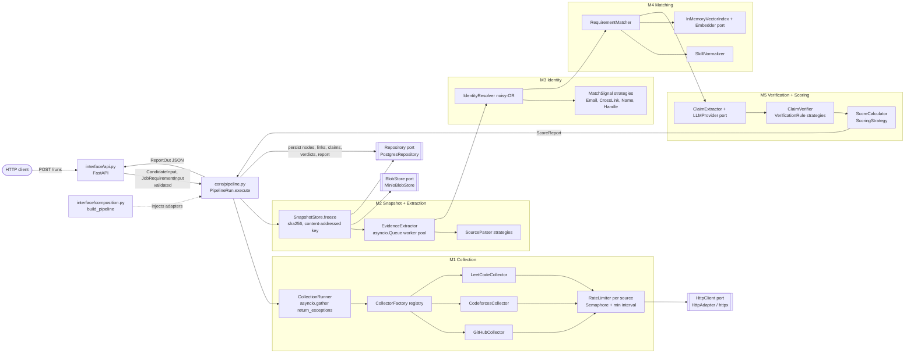

# SE423 Software Construction — Milestone 2 Report

**Project:** OSINT Evidence Pipeline (public developer-profile collection, snapshotting, identity resolution and
explainable evidence scoring)
**Team:** Zain Jamshaid (M1 Source Collection, M4 Semantic Matching) · Rabbin Batool (M2 Snapshot Store & Evidence
Extraction, interface layer, persistence & CI) · Ilsa Maryam (M3 Identity Resolution, M5 Claim Verification &
Scoring; Team Lead / Integrator for M2)
**Repository:** https://github.com/ZainJ5/osint-evidence-pipeline · **Version:** 0.2.0 (`pyproject.toml`)
**Requirement identifiers** (FR / NFR / QR) refer to `docs/requirements.md`.

---

## 1. Working core architecture (20)

### 1.1 What runs end-to-end

The M1 proposal committed to this M2 scope: *"End-to-end skeleton: register candidate, collect from all three sources
concurrently, freeze snapshots, extract evidence with the fake provider, store in PostgreSQL. Factory Method, Adapter
and Strategy present in running code."*

The build goes further than that skeleton. All five modules and the REST API are implemented and run as one pipeline:

| Stage | Requirement | Implemented in | Evidence it runs |
|---|---|---|---|
| Register candidate and job | FR-01 | `pipeline/core/pipeline.py` `PipelineRun.execute` | `tests/system/test_pipeline_system.py` |
| Collect GitHub, Codeforces, LeetCode concurrently, with rate limits and retries | FR-02..FR-05 | `pipeline/core/collection/` | unit + `tests/stress/test_collection_stress.py` |
| Freeze raw responses (MinIO bytes + PostgreSQL metadata) | FR-06 | `pipeline/core/snapshot/store.py` `SnapshotStore` | `tests/integration/test_postgres.py`, `test_minio.py` |
| Extract typed evidence nodes with snapshot id and locator | FR-07 | `pipeline/core/snapshot/extractor.py`, `parsers.py` | `tests/unit/snapshot/` |
| Identity resolution with confidence and rationale, threshold 0.50 | FR-08, FR-09 | `pipeline/core/identity/` | `tests/unit/identity/`, `test_unlinked_account_evidence_is_excluded` |
| Skill normalisation and requirement coverage | FR-10 | `pipeline/core/matching/` | `tests/unit/matching/` |
| Claim extraction, verification and 0–100 score report | FR-11..FR-13 | `pipeline/core/scoring/` | `tests/unit/scoring/` |
| Replay from stored snapshots without network | FR-14, NFR-07 | `PipelineRun.replay` | `test_replay_reproduces_evidence_and_score_without_network` |
| REST API: run, replay, report, delete, plus the read endpoints used by the web UI | FR-15, QR-16 | `pipeline/interface/api.py` | `tests/system/test_api.py` |
| Web UI: resume upload, run progress, collected evidence, claim verdicts and score | FR-15 | `ui/` (Next.js) over the REST API; `pipeline/core/{intake,queries}.py` | `npm run lint`, `npm run build`; API side in `tests/system/` |
| Delete all data of a candidate, blobs included | FR-16 | `PostgresEraser`, `InMemoryEraser` | `test_eraser_removes_every_candidate_row_and_unshared_blobs` |

The full stack also runs on real storage. `tests/integration/test_pipeline_postgres.py::test_full_run_persists_replays_and_deletes_on_real_storage`
executes a run, replays it and deletes the candidate against PostgreSQL 16 and MinIO containers. It passes in CI
(GitHub Actions run 45028442893, PostgreSQL 16 service and MinIO container); see §6.1.

### 1.2 How to run it

```bash
docker compose up -d                                   # postgres:16 and cgr.dev/chainguard/minio
python -m venv .venv && .venv/Scripts/pip install -e ".[dev]"   # Linux/macOS: .venv/bin/pip
set -a; . ./.env.example; set +a                       # DATABASE_URL, MINIO_* (local defaults only)
python -m pipeline.adapters.migrate                    # applies migrations/NNN_*.sql once each
uvicorn pipeline.interface.api:app --reload            # OpenAPI UI at http://localhost:8000/docs
pytest -q -m "not integration" --cov=pipeline/core --cov-report=term
pytest -q -m integration                               # needs the containers and the env vars above
```

If `DATABASE_URL` is not set, the composition root (`pipeline/interface/composition.py` `build_pipeline`) wires
in-memory storage, so the API also runs without Docker for a local demo. The claim provider is chosen in
`build_claim_provider()`: `ClaudeClaimProvider` (Anthropic SDK, structured output) when `ANTHROPIC_API_KEY` is set,
otherwise the deterministic `RuleBasedClaimProvider`, which the tests also use. `HashingEmbedder` is
used in both storage configurations at M2.

Endpoints (`pipeline/interface/api.py`, 10 in total):

| Method and path | Purpose |
|---|---|
| `GET /health` | liveness and the storage backend in use |
| `POST /resumes/parse` | read an uploaded resume (.pdf, .docx, .txt, .md) and return its text, links and handles |
| `POST /runs` | run the whole pipeline synchronously and return the report |
| `POST /runs/start` | start a run in the background (HTTP 202); progress is reported through `RunObserver` |
| `GET /runs` | list runs for the dashboard |
| `GET /runs/{run_id}` | one run with its stage progress, evidence, links, claims and verdicts |
| `GET /snapshots/{snapshot_id}/raw` | the frozen raw bytes of one snapshot, for audit |
| `POST /runs/{run_id}/replay` | recompute from stored snapshots, no network |
| `GET /runs/{run_id}/report` | the stored score report |
| `DELETE /candidates/{candidate_id}` | erase all data of a candidate (FR-16) |

### 1.3 As-built package layout

```
pipeline/
  core/                      # business logic; no I/O library imports (CI-enforced, QR-09)
    ports.py                 # HttpClient, BlobStore, LLMProvider, Embedder, Repository[T], CandidateEraser
    models.py                # frozen dataclasses exchanged between modules
    inputs.py                # CandidateInput, JobRequirementInput, RunConfig (boundary validation)
    errors.py                # PipelineError hierarchy with error codes
    intake.py                # pure helpers: links, handles, email and name guess from resume text
    queries.py               # read side for the web UI: run progress and JSON-ready run views
    skills.py                # curated technology vocabulary shared by M4 and M5
    log.py                   # JSON logging + email scrubbing filter
    pipeline.py              # PipelineRun orchestrator (execute / replay / report / delete_candidate), RunObserver
    collection/              # M1: Collector, CollectorFactory, RateLimiter, CollectionRunner, 3 collectors
    snapshot/                # M2: SnapshotStore, EvidenceExtractor, SourceParser + 3 parsers
    identity/                # M3: MatchSignal + 4 signals, IdentityResolver, profile normalisation
    matching/                # M4: SkillNormalizer, RequirementMatcher, InMemoryVectorIndex, evidence_search
    scoring/                 # M5: ClaimExtractor, VerificationRule + 3 rules, ClaimVerifier, ScoringStrategy
  adapters/
    http.py                  # HttpAdapter (httpx)
    postgres.py              # Database, PostgresRepository, PostgresEraser (psycopg 3)
    minio_store.py           # MinioBlobStore (minio SDK)
    fakes.py                 # in-memory fake for every port + HashingEmbedder
    claude_llm.py            # ClaudeClaimProvider: LLMProvider over the Anthropic SDK
    rule_claims.py           # RuleBasedClaimProvider: deterministic LLMProvider, no model needed
    resume_reader.py         # text of an uploaded resume (.pdf via pypdf, .docx via python-docx, .txt, .md)
    migrate.py               # versioned migration runner (schema_migrations table)
  interface/
    api.py                   # FastAPI app; thin endpoints
    composition.py           # composition root: the only place adapters are chosen
migrations/001_initial.sql   # 9 tables, FK ON DELETE CASCADE from candidates
migrations/002_ui_support.sql # columns the web UI shows (claimed solved count, match details)
ui/                          # Next.js web UI: new-analysis wizard, dashboard, run view (calls the REST API)
docker-compose.yml, .github/workflows/ci.yml, pyproject.toml, .env.example
tests/{unit,system,integration,stress,blackbox,whitebox}/
```

The code is about 4,300 lines of Python and SQL under `pipeline/` and `migrations/` (4,330 by `wc -l` on the
`m2-baseline` code), not counting the `ui/` TypeScript.

### 1.4 As-built flow



`PipelineRun._analyse` (`pipeline/core/pipeline.py`) is shared by `execute` (`persist=True`) and `replay`
(`persist=False`). Unlinked accounts are filtered out before matching:
`evidence = [n for n in nodes if (n.source, n.handle) in linked]`.

### 1.5 Deviations from the M1 design

| # | M1 design | As built | Where | Justification |
|---|---|---|---|---|
| D1 | `HttpClient` exposes `get()` only (ISP) | `HttpClient` also has `post(url, json)` | `pipeline/core/ports.py` `HttpClient`; used by `pipeline/core/collection/leetcode.py` | LeetCode has no public REST profile API. Its public endpoint is GraphQL over POST. `post()` is documented as used only for that. This widens the port, which is a deliberate ISP trade-off. |
| D2 | GitHub commit metadata by `git clone` | REST endpoint `GET /repos/{owner}/{repo}/commits?author={handle}` | `GitHubCollector._commits` | Same authorship data, no disk I/O, and all collection stays inside the official API (NFR-08). An empty repo answers HTTP 409, which is skipped. |
| D3 | Snapshots `UNIQUE (source, sha256)` | `UNIQUE (run_id, endpoint, sha256)`. The blob key `snapshots/{source}/{sha256}` is content-addressed, so identical bytes are stored once. | `migrations/001_initial.sql`; `SnapshotStore.freeze` | Each run needs its own metadata rows for replay and audit (QR-15). Two endpoints can return identical bytes (for example two empty `[]` commit lists), so the endpoint is part of the key. Deduplication moved to the blob layer. `PostgresEraser` deletes only blobs that no other candidate references. |
| D4 | LLM-assisted extraction | Source parsers are deterministic code. The `LLMProvider` port is used only for resume claim extraction (`ClaimExtractor`). Two providers implement it: `ClaudeClaimProvider` (real LLM, used when `ANTHROPIC_API_KEY` is set) and `RuleBasedClaimProvider` (deterministic default, also used by the tests). The earlier pattern-matching `FakeLLMProvider` was removed. | `pipeline/core/snapshot/parsers.py`; `pipeline/core/scoring/claims.py`; `pipeline/adapters/{claude_llm,rule_claims}.py`; `composition.py` `build_claim_provider` | API JSON is structured, so parsing it with an LLM adds cost and non-determinism. The M1 plan deferred a real LLM to M3; it was brought forward because the web UI needs claim extraction from free-form resumes. Replay stays exact (NFR-07) because replay reuses the claims stored with the run instead of calling the provider again. |
| D5 | pgvector index and a local sentence-embedding model | `InMemoryVectorIndex` (cosine) plus `HashingEmbedder` (384-dimension hashed bag of words) | `pipeline/core/matching/vector_index.py`; `pipeline/adapters/fakes.py` | Keeps M2 runnable offline and deterministic. The matcher depends only on the `Embedder` port. pgvector and a real model are deferred to M3. The migration header says so. |
| D6 | All tables append-only | `runs` is the only mutable table (status `running` → `done` / `partial` / `failed`). Every other table is insert-only (`ON CONFLICT DO NOTHING`). | `Table(upsert=True)` only for `runs` in `pipeline/adapters/postgres.py`; `migrations/001_initial.sql` | A run's status has to change. Every other result is a fact with a deterministic id. Checked by `tests/unit/adapters/test_postgres_rows.py::test_runs_are_the_only_upserted_table`. |
| D7 | Erasure not detailed at model level | Every result model carries `candidate_id` (`RunRecord`, `Snapshot`, `EvidenceNode`, `AccountLink`, `Claim`, `Verdict`, `ScoreReport`). All tables reference `candidates` with `ON DELETE CASCADE`. | `pipeline/core/models.py`; `migrations/001_initial.sql` | One `DELETE FROM candidates` erases everything (FR-16). The in-memory eraser filters on the same field. |
| D8 | Signals: email, handle, cross-link | A fourth signal, `NameSignal` (full-name token match, weight 0.5), was added | `pipeline/core/identity/signals.py`; `DEFAULT_SIGNALS` in `resolver.py` | Codeforces rarely exposes email or links. Without a name signal, many real accounts could only link on handle similarity. Adding it needed no change to `IdentityResolver`, which demonstrates the Strategy pattern's OCP benefit. |
| D9 | `minio/minio` image | `cgr.dev/chainguard/minio:latest` | `docker-compose.yml`; `.github/workflows/ci.yml` | `minio/minio` is no longer published on Docker Hub. Chainguard's build runs the same server and the same S3 API. CI starts it with `docker run` because service containers cannot pass `server /data`. |
| D10 | Replay re-runs the pipeline | `replay` recomputes from stored snapshots, **writes nothing**, and returns `ReplayResult(report, evidence_identical, score_identical)`. `score_identical` compares the whole `ScoreReport` (total, components, verdicts). The identity threshold is taken from the config recorded with the run. | `PipelineRun.replay`, `PipelineRun._analyse` | No network access and no side effects. The two flags turn FR-14 / NFR-07 into checks at run time, not only in tests. `RunRecord.replay_of` exists in the schema but is not used yet. |
| D11 | Collector shape not specified | `Collector` is an abstract base class with a fixed `collect()` → `_collect()` skeleton (Template Method) | `pipeline/core/collection/collector.py` | Retry, back-off, rate limiting and JSON validation are identical for every source and are written once. This does not contradict the M1 rejection of Template Method, which was for scoring (§2.3). |
| D12 | One shared rate limiter per source | As designed, but only after a fix during M2. The first build created a `CollectionRunner` inside every `execute()` call, so concurrent runs did not share limiters. Inspection finding INS-01 moved it to `PipelineRun.__init__`. | `PipelineRun.__init__` (`self._runner`) | See §4.3, including the remaining event-loop caveat. |
| D13 | (not in M1) | A job id is bound to one requirement set: re-registering an id with different skills raises `ValidationError(code="JOB_CONFLICT")` (INS-02) | `PipelineRun.register_job` | Without this, a replay could score against a different job than the original run did. |
| D14 | No user interface in M1 scope (API only) | A Next.js web UI (`ui/`) with a resume-upload wizard, dashboard and run view; five API endpoints added for it (§1.2); migration `002_ui_support.sql` | `ui/`; `pipeline/interface/api.py`; `pipeline/core/{intake,queries,skills}.py`; `pipeline/adapters/resume_reader.py` | Makes the pipeline demonstrable to a non-technical user and shows the evidence behind each verdict (QR-03). It sits outside `pipeline/core` and uses only the public API, so the core architecture is unchanged. |
| D15 | Observer considered optional in M1 (§7) | `RunObserver` (Observer pattern) reports stage progress of a run; the API's background runs use it to drive the UI progress timeline | `pipeline/core/pipeline.py` `RunObserver`, `_Stages` | See §2.4. |
| D16 | Two verification rules (skill, rating) | A third rule, `SolvedClaimRule`, verifies "solved N problems" claims against achievement evidence | `pipeline/core/scoring/rules.py`; `default_rules()` | Resumes commonly claim problem counts; adding it needed no change to `ClaimVerifier` (OCP). |

---

## 2. Design patterns implemented correctly (20)

### 2.1 Factory Method with a registry (creational) — `CollectorFactory`

**Problem.** The runner must build the right collector for each source a candidate supplies. It must not know the
concrete classes, and adding a fourth source must not require editing the runner or the factory (QR-12).

**Participants.**

| Role | Class |
|---|---|
| Creator (registry) | `pipeline/core/collection/factory.py` `CollectorFactory` |
| Product (abstract) | `pipeline/core/collection/collector.py` `Collector` |
| Concrete products | `github.py` `GitHubCollector`, `codeforces.py` `CodeforcesCollector`, `leetcode.py` `LeetCodeCollector` |
| Client | `pipeline/core/collection/runner.py` `CollectionRunner` |

```python
# pipeline/core/collection/factory.py
class CollectorFactory:
    _registry: ClassVar[dict[str, type[Collector]]] = {}

    @classmethod
    def register(cls, name: str, collector_cls: type) -> None:
        if not (isinstance(collector_cls, type) and issubclass(collector_cls, Collector)):
            raise ValidationError(f"{collector_cls!r} is not a Collector", context={"field": "collector_cls"})
        cls._registry[name] = collector_cls

    @classmethod
    def create(cls, name, http, config, limiter=None, sleep=asyncio.sleep) -> Collector:
        if name not in cls._registry:
            raise ValidationError(f"unknown source '{name}'", context={"field": "source"})
        return cls._registry[name](http, limiter or cls.create_limiter(name, config), config, sleep=sleep)
```

Each collector module registers itself on its last line, for example
`CollectorFactory.register(GitHubCollector.source_name, GitHubCollector)`. `pipeline/core/collection/__init__.py`
imports the three modules so that registration happens on import.

**Integration.** `PipelineRun.execute` → `CollectionRunner(CollectorFactory, http, config).run(handles)` →
`self._factory.create(source, ...)` for each handle. The factory also creates each source's `RateLimiter` and
enforces the Codeforces API terms (`SOURCE_LIMITS = {"codeforces": {"min_interval": 2.0}}`).

**Maintainability benefit.** A new source needs one file containing a `Collector` subclass and one `register` line.
No `if source == ...` chain exists anywhere in the code base. An unknown source fails at the boundary with
`ValidationError`.

**Rejected alternatives (M1).** An *if/elif chain* in the runner would need an edit for every new source, which
violates OCP and adds to the runner's complexity. *Abstract Factory* creates families of related products. This
project has a single product type, so it would add an extra interface level with nothing to vary.

**Tests.**
- `tests/unit/collection/test_collector_factory.py::test_new_source_plugs_in_without_editing_existing_code`: a
  `StubCollector` defined only in the test is registered and run through the real `CollectionRunner`. This is the
  "stub fourth collector" test. `test_unregistered_stub_is_gone_after_the_test` checks clean-up.
- `test_create_builds_the_registered_class` (parametrised over 3 sources), `test_create_unknown_source_is_a_validation_error`,
  `test_register_rejects_non_collector_classes`, `test_codeforces_limiter_honours_api_terms_of_one_call_per_two_seconds`.

### 2.2 Adapter (structural) — `HttpAdapter`, `PostgresRepository`, `MinioBlobStore`

**Problem.** Core logic needs HTTP, relational storage and object storage. It must not depend on httpx, psycopg or
the minio SDK, or on their exceptions. It must also be testable with in-memory fakes (NFR-04).

**Participants.**

| Target (port, `pipeline/core/ports.py`) | Adapter | Adaptee | Vendor exceptions translated to |
|---|---|---|---|
| `HttpClient` | `pipeline/adapters/http.py` `HttpAdapter` | `httpx.AsyncClient` | `httpx.TimeoutException` → `CollectionError(code="TIMEOUT")`; `httpx.HTTPError` → `CollectionError(code="NETWORK")` |
| `Repository[T]` | `pipeline/adapters/postgres.py` `PostgresRepository` (one generic class configured per table by `Table`) | `psycopg` 3 | `psycopg.Error` → the table's error class (`SnapshotError` for `snapshots`, otherwise `PipelineError`) with `code="DB_ERROR"` and `sqlstate` only (parameters are left out because they may hold personal data) |
| `BlobStore` | `pipeline/adapters/minio_store.py` `MinioBlobStore` | `minio.Minio` | `S3Error NoSuchKey` → `KeyError` (the port contract); other `S3Error`, `MinioException`, `urllib3` errors → `SnapshotError(code="BLOB_STORE_ERROR")` |
| `CandidateEraser` | `PostgresEraser` | SQL + `BlobStore` | through `Database.query` |

```python
# pipeline/adapters/http.py
class HttpAdapter(HttpClient):
    """Adapter: wraps one httpx.AsyncClient behind the HttpClient port."""

    async def _send(self, method: str, url: str, **kwargs) -> HttpResponse:
        try:
            response = await self._client.request(method, url, headers=self._auth_headers(url), **kwargs)
        except httpx.TimeoutException as exc:
            raise CollectionError("request timed out", code="TIMEOUT", context={"url": url}) from exc
        except httpx.HTTPError as exc:
            raise CollectionError(f"network error: {type(exc).__name__}", code="NETWORK", context={"url": url}) from exc
        return HttpResponse(response.status_code, response.content, url)
```

**Integration.** `pipeline/interface/composition.py` `build_pipeline` is the only place that constructs adapters.
It creates `Database`, `build_repositories`, `MinioBlobStore.from_env()`, `PostgresEraser` and `HttpAdapter`, and
injects them into `PipelineRun`. Core code sees only the ports. The `GITHUB_TOKEN` is read from the environment and
sent only to `api.github.com` (`_auth_headers`).

**Maintainability benefit.** Replacing a vendor library changes one adapter file. Core retry logic tests the
transient codes `TIMEOUT` / `NETWORK` and never a library type. Every port has an in-memory fake in
`pipeline/adapters/fakes.py`, so every test outside `tests/integration/` (546 at the last run) runs without
containers.

**Rejected alternatives (M1).** *Calling the libraries directly* from core would couple business logic to vendor
types and exceptions, and would make core untestable without network and databases. A *Facade* simplifies a
subsystem but keeps the vendor's vocabulary. It does not convert to an interface that core owns, so the dependency
direction would stay wrong.

**Tests.**
- `tests/unit/adapters/test_http_adapter.py::test_transport_errors_become_collection_errors` (parametrised, uses
  `httpx.MockTransport`), `test_github_token_sent_only_to_github`, `test_non_2xx_status_is_returned_not_raised`.
- `tests/integration/test_postgres.py::test_snapshot_insert_violating_foreign_key_raises_snapshot_error` checks
  translation of a real `psycopg` FK violation.
- `tests/integration/test_minio.py::test_tampered_blob_in_minio_raises_snapshot_error`, `test_put_get_delete_round_trip`.
- `tests/unit/adapters/test_postgres_rows.py` (row mapping, `test_list_by_rejects_unknown_columns`).

### 2.3 Strategy (behavioural) — `MatchSignal`, `VerificationRule`, `ScoringStrategy`

**Problem.** Identity matching, claim verification and scoring each need interchangeable algorithms: new signals,
new claim kinds, alternative weightings. The calling code must not change when one is added or swapped.

**Participants.**

| Strategy interface | Concrete strategies | Context |
|---|---|---|
| `pipeline/core/identity/signals.py` `MatchSignal` | `EmailSignal`, `CrossLinkSignal`, `NameSignal`, `HandleSignal` | `identity/resolver.py` `IdentityResolver` (list of `(signal, weight)`, fused by noisy-OR) |
| `pipeline/core/scoring/rules.py` `VerificationRule` | `SkillClaimRule`, `RatingClaimRule`, `SolvedClaimRule` | `scoring/verifier.py` `ClaimVerifier` (dispatch by `rule.kind`) |
| `pipeline/core/scoring/scoring.py` `ScoringStrategy` | `WeightedEvidenceScoring` | `scoring/scoring.py` `ScoreCalculator` |
| (additional) `pipeline/core/snapshot/parsers.py` `SourceParser` | `GitHubParser`, `CodeforcesParser`, `LeetCodeParser` | `snapshot/extractor.py` `EvidenceExtractor` (dispatch by `snapshot.source`) |

```python
# pipeline/core/scoring/scoring.py
class ScoringStrategy(ABC):
    @abstractmethod
    def score(self, run_id, candidate_id, job_id, verdicts, match, evidence) -> ScoreReport: ...


class ScoreCalculator:
    """Context of the Strategy pattern: swap the scoring strategy through the constructor."""

    def __init__(self, strategy: ScoringStrategy):
        self._strategy = strategy

    def calculate(self, run_id, candidate_id, job_id, verdicts, match, evidence) -> ScoreReport:
        return self._strategy.score(run_id, candidate_id, job_id, verdicts, match, evidence)
```

```python
# pipeline/core/identity/resolver.py — IdentityResolver._compare
for signal, weight in self._signals:
    result = signal.score(a, b)
    if result.score > 0:
        miss *= 1.0 - weight * result.score
        fired.append(f"{result.signal} ({result.score:.2f}) on {_label(a)}~{_label(b)}: {result.reason}")
return round(1.0 - miss, 4), fired
```

**Integration.** `PipelineRun._analyse` builds `IdentityResolver(threshold=...)` with `DEFAULT_SIGNALS`, using the
link threshold recorded in the run's config (INS-03). `PipelineRun.__init__` builds
`ClaimVerifier(default_rules(normalizer))` (`SkillClaimRule`, `RatingClaimRule`, `SolvedClaimRule`) and
`ScoreCalculator(scoring or WeightedEvidenceScoring())`. The `scoring` constructor parameter lets a caller inject a
different strategy without touching the orchestrator.

**Maintainability benefit.** `NameSignal` (deviation D8) was added without any edit to `IdentityResolver`. Each
signal or rule is a small class with its own unit-test file. Every strategy returns a reason string, so the rationale
is produced by the same object that made the decision (explainability, QR-03).

**Rejected alternatives (M1).** *One large scoring function with flags* would mix every algorithm in one place, grow
in cyclomatic complexity (QR-11 limit 10) and force a retest of everything on each change. *Template Method* fixes the
algorithm's skeleton in a base class and varies steps through inheritance. The scoring and signal algorithms do not
share a skeleton, and inheritance would prevent combining strategies at runtime, such as the resolver's weighted list
or a weight override per job. Template Method is used only where a skeleton does exist: the `Collector` retry
pipeline (D11).

**Tests.**
- Strategy swap: `tests/unit/scoring/test_scoring.py::test_calculator_delegates_to_the_injected_strategy`
  (`StubStrategy` returns 42.0) and `test_calculator_with_default_strategy`.
- Signals: `tests/unit/identity/test_email_signal.py`, `test_handle_signal.py`, `test_crosslink_signal.py`,
  `test_name_signal.py`. Context: `test_resolver.py::test_signals_combine_as_noisy_or`,
  `test_invalid_signal_configuration_raises`, `test_threshold_boundary`.
- Rules: `tests/unit/scoring/test_verifier.py::test_each_claim_goes_to_the_rule_for_its_kind`,
  `test_unknown_claim_kind_raises`, `test_skill_rule.py`, `test_rating_rule.py`.

### 2.4 Observer (behavioural) — `RunObserver`

**Problem.** A run started with `POST /runs/start` executes in the background, and the web UI must show which stage
it is in. The orchestrator must not know who is watching (a progress store, a log, a test recorder), and a broken
watcher must never fail a run.

**Implementation.** `RunObserver` is an abstract subject-to-observer interface with one method,
`on_event(run_id, stage, status, detail)`. `PipelineRun.execute(..., observer=None)` wraps it in `_Stages`, which
notifies `started` and `done` for each stage (collect, freeze, extract, resolve, match, verify, score). The API passes its in-memory
progress store as the observer (`pipeline/interface/api.py`); the UI polls `GET /runs/{run_id}` to render the
timeline. `_Stages._notify` catches any exception from the observer, logs `observer_failed` and continues (§3.5).

**Tests.** `tests/system/test_pipeline_observer.py::test_observer_sees_every_stage_start_and_finish_in_order` and
`test_a_failing_observer_never_breaks_the_run`.

---

## 3. Defensive programming and exception handling (10)

### 3.1 Validation at the boundaries

| Boundary | Validator | What is checked |
|---|---|---|
| API body | `pipeline/interface/api.py` Pydantic models (`CandidateBody`, `JobBody`) | types and required fields |
| Domain entry | `pipeline/core/inputs.py` `CandidateInput.__post_init__` | name 1–200 characters and not blank; email regex; resume 1–20,000 characters; source in `SOURCES`; per-source handle regex (GitHub ≤39 characters, no leading or double hyphen) |
| | `JobRequirementInput.__post_init__` | id and title present; 1–50 required skills; no blank skills |
| | `RunConfig.__post_init__` | `link_threshold` ∈ [0,1]; `max_requests_per_source` ≥1; `min_interval_seconds` ≥0; `max_retries` ∈ [0,3]; `extraction_workers` ≥1 |
| Component constructors | `RateLimiter`, `EvidenceExtractor`, `IdentityResolver`, `RequirementMatcher`, `WeightedEvidenceScoring` (`_validated`), `CollectorFactory.register` | raise `ValidationError` / `ResolutionError` / `ScoringError` for invalid configuration |
| External data | `Collector._accept` (status and JSON), source envelope checks (`CodeforcesCollector` status `OK`, LeetCode `data`), `parsers.expect()` (JSON shape), `ClaimExtractor` (drops malformed LLM items and rejects a malformed top level with `LLM_BAD_OUTPUT`) | |
| Snapshot load | `SnapshotStore.load` | recomputes SHA-256 and raises `SnapshotError(code="HASH_MISMATCH")` on tampering (QR-14) |
| Repository filters | `PostgresRepository.list_by` | unknown column → `ValidationError` (no column name from a caller reaches SQL; identifiers are built with `psycopg.sql.Identifier`) |

Boundary tests: `tests/unit/collection/test_candidate_input.py` (boundary values 0/1/200/201, 39/40, 20,000/20,001),
`tests/system/test_api.py::test_invalid_input_is_rejected_at_the_boundary` (HTTP 422, `code = VALIDATION_ERROR`) and
the black-box suite `tests/blackbox/test_bb_inputs.py`.

**Validation gaps found by black-box testing.** These were recorded as strict `xfail` at test design and then fixed
in `pipeline/core/inputs.py` with two helpers, `_check_int` (whole numbers, booleans rejected) and `_check_number`
(finite numbers only); the tests now pass:

| ID | Gap |
|---|---|
| BB-DEF-01 | `RunConfig` accepts non-integer counts |
| BB-DEF-02 | `min_interval_seconds = NaN` is accepted and disables rate limiting |
| BB-DEF-03 | `max_repos` is never validated |
| BB-DEF-04 | a whitespace-only job title is accepted |

All four are closed (CAPA in `docs/milestone2/blackbox-test-design.md` §13.1).

### 3.2 Exception hierarchy and the error codes actually used

`pipeline/core/errors.py`: `PipelineError(message, code=None, context=None)` carries a stable `code` and a `context`
dict for structured logs. The codes below come from `grep -rnoE 'code="..."' pipeline`.

| Class | Default code | Codes raised in the code base (file) |
|---|---|---|
| `PipelineError` | `PIPELINE_ERROR` | `CONFIG_ERROR` (`adapters/postgres.py` `Database.from_env`), `DB_ERROR` (`Database.query`) |
| ├─ `ValidationError` | `VALIDATION_ERROR` | `RUN_NOT_FOUND`, `CANDIDATE_NOT_FOUND`, `JOB_CONFLICT` (`core/pipeline.py`) |
| ├─ `CollectionError` | `COLLECTION_ERROR` | `TIMEOUT`, `NETWORK` (`adapters/http.py`); `HTTP_<status>`, `NOT_FOUND`, `MALFORMED_BODY` (`collection/collector.py`, `leetcode.py`); `NETWORK_DISABLED` (`adapters/fakes.py` `OfflineHttpClient`) |
| ├─ `SnapshotError` | `SNAPSHOT_ERROR` | `NOT_FOUND`, `HASH_MISMATCH` (`snapshot/store.py`); `BLOB_STORE_ERROR` (`adapters/minio_store.py`); `DB_ERROR` for the snapshots table |
| ├─ `ExtractionError` | `EXTRACTION_ERROR` | `INVALID_JSON`, `UNKNOWN_SOURCE` (`snapshot/extractor.py`); `UNEXPECTED_SHAPE` (`snapshot/parsers.py`) |
| ├─ `ResolutionError` | `RESOLUTION_ERROR` | default code (`identity/profiles.py`, `identity/resolver.py`) |
| ├─ `MatchingError` | `MATCHING_ERROR` | default code (`matching/matcher.py`, `matching/vector_index.py`) |
| └─ `ScoringError` | `SCORING_ERROR` | `LLM_BAD_OUTPUT` (`scoring/claims.py`); default code (`scoring/scoring.py`, `scoring/verifier.py`) |

`ValidationError` is an addition to the M1 hierarchy. Each is handled as follows:

- **Partial failure (NFR-02 / QR-04).** `CollectionRunner.run` uses `asyncio.gather(..., return_exceptions=True)`.
  A `CollectionError` from one source becomes a `(source, code)` entry in `CollectionResult.failures`, and the run
  finishes `partial`. Any other exception is re-raised, because it indicates a bug rather than a source failure.
  Test: `tests/system/test_pipeline_system.py::test_one_source_failing_gives_partial_run_with_other_evidence`
  (GitHub 503 → `("github", "HTTP_503")`, Codeforces and LeetCode evidence still present).
- **Retry policy.** `Collector._fetch` retries at most `max_retries` (≤3) times with back-off 0.5 s, 1 s, 2 s, and
  only for `TIMEOUT` / `NETWORK` / HTTP 429 / HTTP 5xx. Tests: `tests/unit/collection/test_collector_retry.py`
  (12 test functions).
- **Run failure.** `PipelineRun.execute` catches `PipelineError`, writes the run as `failed` (`_fail`), logs
  `run_failed` with the code, and re-raises. Any other exception is also recorded as `failed` with the log code
  `UNEXPECTED_ERROR` and then re-raised, so a bug can never leave a run stuck in `running` (INS-04).
- **API mapping.** `create_app` registers one `PipelineError` handler. `ValidationError` → 422, codes ending in
  `NOT_FOUND` → 404, everything else → 502. The response body is `{code, message}`; no stack trace is exposed.
- **Exception chaining.** Every translation uses `raise ... from exc`, so the original cause is kept for debugging.

### 3.3 Where vendor exceptions are translated

There are exactly three places, all in `pipeline/adapters/`: `http.py` `HttpAdapter._send`, `postgres.py`
`Database.query`, and `minio_store.py` `MinioBlobStore.get` / `_call`. Nothing under `pipeline/core/` imports
`httpx`, `psycopg` or `minio`. The CI dependency-direction grep enforces the package side of this rule (§5.2).

### 3.4 Logging (`pipeline/core/log.py`)

- `JsonFormatter` writes one JSON object per line: `level`, `logger`, `event` and the structured `fields`.
- `EmailScrubFilter` replaces anything matching `[\w.+-]+@[\w-]+\.[\w.-]+` with `[email]`, in the message and
  recursively in the fields (NFR-06, QR-13).
- `log_event(logger, event, **fields)` is the only logging call in the pipeline. `PipelineRun` emits `run_started`,
  `stage_done` (with `stage` = collect / extract / resolve / score), `run_finished`, `run_failed`, `run_replayed`,
  `candidate_deleted` and `profile_skipped`. Each carries `run_id` and `candidate_id`.
- Tests: `tests/unit/core/test_log.py::test_email_in_message_is_scrubbed`, `test_email_in_structured_fields_is_scrubbed`,
  `test_log_event_never_outputs_email`.

### 3.5 No bare `except`

There is no bare `except:`. `grep -rnE "except\s*:|except Exception|except BaseException" pipeline` returns three broad
handlers. Two re-raise; one deliberately does not:

| Handler | Purpose | Test |
|---|---|---|
| `pipeline/core/collection/rate_limiter.py` `RateLimiter.__aenter__`: `except BaseException: self._semaphore.release(); raise` | releases the slot if the caller is cancelled while waiting | `tests/unit/collection/test_rate_limiter.py::test_slot_is_released_when_the_body_raises` |
| `pipeline/core/pipeline.py:165` `PipelineRun.execute`: `except Exception` | records the run as `failed`, then `raise` (INS-04) | `tests/system/test_inspection_m2.py::test_ins04_unexpected_error_marks_the_run_failed` |
| `pipeline/core/pipeline.py:85` `_Stages._notify`: `except Exception` | **does not re-raise.** An observer is a progress display; if it fails, the run must still finish. The exception type is logged as `observer_failed` at WARNING. | `tests/system/test_pipeline_observer.py` (`Broken` observer) |

The third handler is the only place an exception is swallowed, it is limited to observer callbacks, and it is logged. Every other handler names specific exception types. Ruff (rules E, F, W, I, B, C90, UP, SIM) reports
"All checks passed!".

---

## 4. Concurrency and thread safety (15)

### 4.1 Concurrent operations and the strategy for each

The concurrency model is `asyncio` on a single thread, so there is no data race between coroutines. Shared state is
reduced to the per-source rate limiter and the extractor's result list. The table cites lines from the `m2-baseline` code.

| Operation | Strategy | Code |
|---|---|---|
| Collect three sources for one candidate in parallel (FR-05, NFR-01) | fan-out with `asyncio.gather(*..., return_exceptions=True)`; one failing source cannot cancel the others | `pipeline/core/collection/runner.py:37` |
| Concurrent runs | one `CollectionRunner` per `PipelineRun`, so all runs share one limiter per source (INS-01, §4.3) | `pipeline/core/pipeline.py:118` |
| Respect source rate limits (NFR-01, QR-08) | per-source `RateLimiter`: `asyncio.Semaphore(max_concurrent)` bounds requests in flight; an `asyncio.Lock` serialises the "next start time" check so two coroutines cannot both pass the minimum gap; `while now < ready_at` re-checks after sleeping because timers can wake early | `rate_limiter.py:21-22, 33-54` |
| Source terms | the Codeforces minimum interval is raised to 2.0 s whatever `RunConfig` says | `factory.py` `SOURCE_LIMITS`, `create_limiter` |
| Parse snapshots (FR-07) | bounded worker pool: `extraction_workers` coroutines drain an `asyncio.Queue`; results are sorted by `(source, endpoint, locator, kind, id)`, so output does not depend on scheduling | `snapshot/extractor.py:29-35, 46-51` |
| Data passed between stages | all models are `@dataclass(frozen=True)`; collections inside them are tuples | `pipeline/core/models.py` |
| Idempotent writes | snapshot ids are `uuid5(run_id:source:endpoint:sha256)` and evidence ids are `uuid5(run_id:snapshot_id:kind:locator)`; PostgreSQL inserts use `ON CONFLICT (...) DO NOTHING`; `freeze` returns the existing snapshot when called twice | `snapshot/store.py:24-27`; `parsers.py` `make_node`; `adapters/postgres.py` `PostgresRepository.add` |
| Crash ordering | blob is written before its metadata row (a crash leaves an orphan blob, never a dangling row); the eraser deletes rows before blobs | `SnapshotStore.freeze`; `PostgresEraser.delete_candidate` |
| Database access from the API | FastAPI may call sync code from a thread pool; `Database` keeps one connection guarded by a `threading.Lock` | `adapters/postgres.py` `Database.query` |
| Registry | `CollectorFactory._registry` is class-level mutable state, but it is written only at import time (and by tests through `register` / `unregister`) and read afterwards | `factory.py` |

### 4.2 Stress test and what it asserts

`tests/stress/test_collection_stress.py::test_twenty_candidates_overlap_across_sources_but_respect_per_source_intervals`
(QR-08, NFR-01):

- 20 candidates × 3 sources go through **one** `CollectionRunner` with shared limiters (`RateLimiter(2, interval)`;
  intervals 30 ms GitHub, 40 ms Codeforces, 30 ms LeetCode). `FakeHttpClient` adds 10 ms latency and records a
  timestamp for every call; a test subclass of `RateLimiter` records when each slot is granted.
- Assertion 1: every candidate's result is complete (`not r.partial and len(r.fetches) == 8`).
- Assertion 2, **zero rate-limit violations**: for each source, the smallest gap between consecutive limiter grants
  is ≥ 75 % of the interval (two calls let through together would give a gap near 0).
- Assertion 3, **overlap**: the time spans of all source pairs intersect, so the sources really ran concurrently.

Supporting unit tests in `tests/unit/collection/test_rate_limiter.py` use an injected fake clock and sleep, so they
are deterministic: `test_concurrent_callers_are_spaced_by_interval`, `test_in_flight_requests_never_exceed_bound`,
`test_no_wait_when_elapsed_equals_interval`, `test_waits_remainder_when_elapsed_is_just_below_interval`. In
`test_collection_runner.py`: `test_runner_reuses_one_limiter_per_source_across_runs`.

**Observed flakiness and fix.** The first version measured gaps between HTTP call timestamps with a 1 ms tolerance
and failed about once in ten runs on a busy Windows machine (one gap of 8.9 ms against a 10 ms interval, caused by
event-loop and OS scheduling jitter, not by the limiter). It now measures limiter grant times, uses slightly longer
intervals and a 25 % tolerance; the exact interval arithmetic stays covered by the fake-clock unit tests above.
After the change it passed 20 of 20 consecutive runs.

### 4.3 RateLimiter scope and the event loop

**History.** The first M2 build created a new `CollectionRunner(CollectorFactory, self._http, self._config)` inside
every `PipelineRun.execute` call. Each run therefore had its own limiters, and the limiters always belonged to the
event loop of that call. The cost was that two `POST /runs` requests running at the same time did **not** share a
limiter, so together they could exceed a source's rate.

The SE431 M2 inspection recorded this as INS-01. The runner is now created once in `PipelineRun.__init__`
(`pipeline/core/pipeline.py:118`, `self._runner`). Every run of one pipeline instance shares one limiter per source
(`CollectionRunner.limiter_for`), which is the configuration the stress test exercises.

**Remaining caveat.** `RateLimiter` creates its `asyncio.Semaphore` and `asyncio.Lock` in `__init__`. In Python 3.10+
these primitives bind to the first event loop on which they have to wait. Under uvicorn the application runs on one
loop, so this is safe. A single `PipelineRun` driven from several event loops (for example repeated `asyncio.run`
calls) could hit `RuntimeError: ... is bound to a different event loop` once a limiter has contended on an earlier
loop. Recreating limiters per loop (a registry keyed by the running loop) is listed for M3.

---

## 5. Code quality and SOLID adherence (15)

### 5.1 SOLID with as-built evidence

| Principle | Evidence |
|---|---|
| **SRP** | Each class has one reason to change. `SnapshotStore` handles freeze, load and verify only. `EvidenceExtractor` schedules work; parsing lives in `SourceParser` subclasses. `RateLimiter` paces requests only. `ClaimExtractor` validates LLM output; `ClaimVerifier` dispatches; rules judge; `ScoreCalculator` delegates. `PipelineRun` only orders the stages; its docstring says it is "the only class that knows the order of the ESRC stages". `api.py` endpoints convert DTOs and call the orchestrator, with no business logic. |
| **OCP** | New source: a `Collector` subclass plus `register()` (`test_new_source_plugs_in_without_editing_existing_code`). New signal: `NameSignal` was added without editing `IdentityResolver`. New claim kind: a `VerificationRule` subclass passed to `ClaimVerifier`. New scoring: a `ScoringStrategy` injected through `PipelineRun(scoring=...)`. |
| **LSP** | `tests/unit/collection/test_collector_contract.py` runs every registered collector (`SOURCES = CollectorFactory.registered()`) against 10 hostile outcomes: 404, 503, garbage, `null`, list, object, string, odd shape, timeout, network. Each must return a `list[RawFetch]` tagged with its own source, or raise `CollectionError`; never `None` and never a library exception. That is 30 parametrised cases plus 3 happy-path cases. **Known LSP gap:** `InMemoryRepository.add` overwrites an existing key, while `PostgresRepository.add` ignores duplicates (`DO NOTHING`) except for `runs`. Because ids are deterministic and content-derived, both give the same observable results in the current code paths. A shared repository contract test is planned for M3. |
| **ISP** | Ports are small and role-specific. `BlobStore` has put/get/delete. `Repository[T]` has add/get/list_by and deliberately **no** `update` (the docstring says so). Erasure is a separate `CandidateEraser` port instead of a `delete` on every repository. `LLMProvider` has one method, `complete`. `Embedder` has one method, `embed`. The deviation is `HttpClient.post` (D1), needed only by LeetCode. |
| **DIP** | `PipelineRun.__init__` takes `Repositories`, `BlobStore`, `HttpClient`, `LLMProvider`, `CandidateEraser`, `Embedder` and `ScoringStrategy`, all abstractions from `pipeline/core/ports.py` or core. `pipeline/interface/composition.py` `build_pipeline` is the single place that picks concrete adapters. **Limitation:** `PipelineRun.__init__` still constructs its core collaborators itself (`SkillNormalizer`, `IdentityResolver`, rules), so they can only be swapped by changing the constructor (smell S2 in §8). |

### 5.2 Cohesion and coupling

- **Data coupling through value objects.** Modules exchange only the frozen dataclasses in `pipeline/core/models.py`.
  M1 produces `RawFetch` / `CollectionResult`; M2 produces `Snapshot` / `EvidenceNode`; M3 `AccountRef` /
  `AccountLink` / `CandidateProfile`; M4 `SkillMatch` / `MatchResult`; M5 `Claim` / `Verdict` / `ScoreComponent` /
  `ScoreReport`. No module reaches into another module's internals. For example M5 reads only `EvidenceNode.kind` and
  `.value`. The one shared helper across modules is `SkillNormalizer` (M4), used by M5 rules so that matching and
  verification normalise skills the same way.
- **Functional cohesion.** Each sub-package corresponds to one module and requirement group, as listed in §1.1.
- **Dependency direction, enforced in CI.** The step in `.github/workflows/ci.yml`:
  ```yaml
  - name: Dependency direction (QR-09: core must not import adapters or interface)
    run: '! grep -rnE "from pipeline\.(adapters|interface)|import pipeline\.(adapters|interface)" pipeline/core'
  ```
  Run locally and in CI, it found no matches (grep exit 1), so the CI step passes.
- **Complexity.** Ruff `C90` with `max-complexity = 10` (`pyproject.toml`) is part of `ruff check .`. It reports
  "All checks passed!", so no function exceeds complexity 10 (QR-11).
- **Static analysis results (local and in CI).** `ruff check .` → All checks passed. `ruff format --check .` →
  127 files already formatted (this report included, because Ruff also formats Python blocks in Markdown). `pylint pipeline --fail-under=9` → **10.00/10**. Before and after records are in
  `docs/records/m2/static-analysis-before/` and `docs/records/m2/static-analysis-after/`.

---

## 6. TDD and the automated-test baseline (10)

### 6.1 Test counts and coverage (measured)

Commands run on the `m2-baseline` code, locally (Windows 11, Python 3.10) and in GitHub Actions (Ubuntu, Python 3.12):

```
.venv/Scripts/python -m pytest -q -m "not integration" --cov=pipeline/core --cov-report=term
  → 723 passed, 11 deselected                 TOTAL 1642 stmts, 22 missed, 99%

set -a; . ./.env.example; set +a; .venv/Scripts/python -m pytest -q -m integration
  → 11 passed, 723 deselected

set -a; . ./.env.example; set +a; .venv/Scripts/python -m pytest -q --cov=pipeline/core --cov-branch --cov-report=term
  → 734 passed                                  TOTAL 1642 stmts, 22 missed, 380 branches, 12 partial, 98%

GitHub Actions (all gates, integration tests included), run 45028442893:
  → 734 passed in 34.68s                        TOTAL 1642 stmts, 22 missed, 99%
```

The integration tests ran against real **PostgreSQL 16** (`postgres:16`) and **MinIO**
(`cgr.dev/chainguard/minio:latest`) containers started by `docker compose up -d`. The schema was applied with
`python -m pipeline.adapters.migrate`. Black-box defects BB-DEF-01..04 (§3.1) were fixed after test design, so
their former strict-xfail tests now pass. Full output: `docs/records/m2/coverage-full.txt`.

Line coverage of `pipeline/core` is **99 %** (1,642 statements, 22 missed; 380 branches, 12 partial), well above the
60 % gate (NFR-04, QR-10). Every core module is at or above 91 %; `queries.py` (the web UI read side) is the lowest. Across the coverage runs
made while writing this report (between 98 % and 99 % as the code changed), one run reported 84 %. That run
coincided with other processes writing the shared `.coverage` file, and it did not reproduce.

Tests collected: **734** (`pytest --collect-only`; parametrised cases counted individually).

| Directory | Tests | What it covers |
|---|---:|---|
| `tests/unit/collection/` | 131 | input boundaries, factory and OCP stub, LSP contract, retry policy, rate limiter, runner, three collectors |
| `tests/unit/identity/` | 71 | four signals, profile normalisation, resolver (threshold boundary, noisy-OR, one-hop links), inspection regression |
| `tests/unit/matching/` | 73 | alias and compiler-name normalisation, vector index, requirement matcher, evidence search |
| `tests/unit/scoring/` | 93 | claim extraction, skill, rating and solved rules, verifier, scoring strategy |
| `tests/unit/snapshot/` | 35 | freeze, hash verification and tampering, extractor determinism, parsers |
| `tests/unit/adapters/` | 94 | `HttpAdapter` with `httpx.MockTransport`, PostgreSQL row mapping, resume reader, rule-based and Claude claim providers |
| `tests/unit/core/` | 12 | JSON logging and email scrubbing, resume intake helpers |
| `tests/system/` | 35 | whole pipeline on in-memory adapters and recorded fixtures (`tests/fixtures/`), REST API incl. UI endpoints, observer, OpenAPI schema |
| `tests/stress/` | 1 | 20-candidate concurrency (§4.2) |
| `tests/integration/` | 11 | PostgreSQL and MinIO round trips, idempotent freeze, FK error translation, eraser, full run on real storage |
| `tests/blackbox/` | 144 | SE431 black-box suite (equivalence classes and boundary values) |
| `tests/whitebox/` | 34 | SE431 white-box basis-path tests |
| **Total** | **734** | |

Counts regenerated on the `m2-baseline` code. Regenerate with the same commands if code changes before submission.

### 6.2 TDD process

Tests were written per class before the implementation, run to confirm they failed, and then the implementation was
written until they passed. Examples visible in the test design:

- boundary-value tests for `CandidateInput` were written from the M1 specification (lengths 0/1/200/201, GitHub
  handles 39/40);
- the fake clock and fake sleep injected into `RateLimiter` and `Collector` exist so that the spacing tests could be
  written before any real timing code;
- the `StubCollector` OCP test was written against the factory interface.

`docs/ai-usage-log.md` records how AI assistance was used for each module.

**Commit history.** The M2 work is on `main` through one feature branch per module (`feature/m2-*`), merged by pull
request; on each branch the tests and the implementation are committed separately. From M3 every branch starts with
a commit that adds the failing test (§6.3), which the SCM audit checks (`docs/milestone2/scm.md` §7).

### 6.3 Commit discipline from M3 onwards

The M2 work reached `main` through these branches, each merged with a merge commit (`git log --merges main`).
The ordering rules in step 4 apply to all work from M3.

| Branch | Committed by | Branch | Committed by |
|---|---|---|---|
| `feature/m2-core-shared` | Zain Jamshaid | `feature/m2-rest-api` | Rabbin Batool |
| `feature/m2-candidate-intake` | Zain Jamshaid | `feature/m2-web-ui` | Ilsa Maryam |
| `feature/m2-source-collection` | Zain Jamshaid | `feature/m2-blackbox-tests` | Rabbin Batool |
| `feature/m2-http-adapter` | Rabbin Batool | `feature/m2-whitebox-tests` | Ilsa Maryam |
| `feature/m2-snapshot-store` | Rabbin Batool | `feature/m2-inspection` | Zain Jamshaid |
| `feature/m2-identity-resolution` | Ilsa Maryam | `feature/m2-static-analysis` | Rabbin Batool |
| `feature/m2-semantic-matching` | Zain Jamshaid | `feature/m2-vv-plan` | Ilsa Maryam |
| `feature/m2-claim-scoring` | Ilsa Maryam | `feature/m2-scm` | Zain Jamshaid |
| `feature/m2-pipeline-replay` | Rabbin Batool | `feature/m2-reports` | Zain Jamshaid |
| `feature/m2-postgres-persistence` | Rabbin Batool | | |

Rules for every branch from M3:

1. One branch per feature or fix: `feature/m3-<topic>`, `fix/m3-<topic>`, `docs/m3-<topic>`.
2. A shared-contract change (`ports.py`, `models.py`, `errors.py`) is its own branch, merged first.
3. Open an issue for the work before the branch, and reference it from the pull request.

4. On each branch, commit **per class** in three steps:
   1. `Added failing tests for <Class>`: only the test file. Run `pytest` and keep the failing output for the PR
      description.
   2. `Implemented <Class>`: the production file, with tests now green.
   3. `Refactored <Class>: <what>`: only when a refactoring was made, such as an extracted helper or a renamed field.
5. Open a PR per branch with the linked issue, CI green, and one approval from a member who is not the author. Merge
   with **merge commits; no squash and no rebase**, so the test → implementation → refactor commits stay on `main`.
6. After all merges, `main` must reproduce the reported numbers. Then tag the milestone baseline (`m3-baseline`).

Commits are never back-dated or rewritten. The evidence of test-first work is the order of commits within each
branch.

---

## 7. Repository discipline and contribution traceability (10)

The SCM procedures are described in full in `docs/milestone2/scm.md`. They are summarised here.

### 7.1 Branch strategy and PR rules

- `main` is protected and is changed only through pull requests (branch protection rule on `main`: one approving
  review, CODEOWNERS review, the CI `test` check, no force pushes or deletion).
- Use feature branches `feature/m2-<module>` (§6.3). For M3: `feature/m3-<topic>`, `fix/<issue-id>-<topic>`.
- Every PR needs:
  - a linked issue;
  - a green CI run;
  - one approving review from a member who is not the author;
  - test-first commits;
  - merge commits only.
- A PR that touches the shared contracts (`ports.py`, `models.py`, `errors.py`) needs approval from both other
  members, because it changes the interfaces of all modules.

### 7.2 Issue labels

| Group | Labels |
|---|---|
| Module | `M1-collection`, `M2-snapshot`, `M3-identity`, `M4-matching`, `M5-scoring`, `interface`, `persistence-ci` |
| Type | `feature`, `test`, `refactor`, `bug`, `docs` |
| Severity (defects) | `critical`, `high`, `medium`, `low` (QR-06: no open critical or high defect at submission) |
| Origin | `blackbox`, `static-analysis`, `inspection` |

Defects are tracked as GitHub issues with these labels: the inspection findings INS-01..12 and the black-box defects
BB-DEF-01..04 each have an issue, closed once fixed or left open with its M3 owner.

### 7.3 Module ownership

| Path | Owner | Notes |
|---|---|---|
| `pipeline/core/collection/` | Zain Jamshaid | M1 |
| `pipeline/core/matching/` | Zain Jamshaid | M4 |
| `pipeline/core/inputs.py` | Zain Jamshaid | boundary models (tests in `tests/unit/collection/test_candidate_input.py`) |
| `pipeline/core/snapshot/` | Rabbin Batool | M2 |
| `pipeline/adapters/` (`http.py`, `postgres.py`, `minio_store.py`, `migrate.py`, `fakes.py`) | Rabbin Batool | adapters and persistence |
| `pipeline/interface/` (`api.py`, `composition.py`) | Rabbin Batool | interface layer |
| `pipeline/core/log.py` | Rabbin Batool | logging |
| `migrations/`, `docker-compose.yml`, `.github/workflows/ci.yml`, `pyproject.toml`, `.env.example` | Rabbin Batool | persistence and CI |
| `pipeline/core/identity/` | Ilsa Maryam | M3 |
| `pipeline/core/scoring/` | Ilsa Maryam | M5 |
| `pipeline/core/pipeline.py`, `pipeline/core/queries.py` | Rabbin Batool | orchestrator and UI read side; Ilsa Maryam reviews as M2 integrator |
| `pipeline/core/{ports,models,errors,inputs,intake,skills}.py` | Zain Jamshaid | shared contract; changes need approval from all three members |
| `ui/` | Ilsa Maryam | web UI |
| `tests/unit/<module>/`, `tests/stress/` | owner of the module under test | `tests/stress/` → Zain |
| `tests/unit/adapters/`, `tests/integration/`, `tests/system/test_api.py` | Rabbin Batool | |
| `tests/system/`, `tests/fixtures/` | Rabbin Batool | |
| `tests/blackbox/` | Rabbin Batool | SE431 black-box design lead |
| `tests/whitebox/` | Ilsa Maryam | SE431 white-box design lead |

`.github/CODEOWNERS` holds this mapping, so GitHub requests the owner's review automatically on every pull request.

### 7.4 CI gates (`.github/workflows/ci.yml`)

The workflow runs on every push and pull request, on Ubuntu with a PostgreSQL 16 service and a MinIO container.
Gates in order:

1. gitleaks secret scan of the full history (`fetch-depth: 0`, QR-13)
2. `ruff check .` (includes C901 ≤ 10)
3. `ruff format --check .`
4. `pylint pipeline --fail-under=9.9`
5. dependency-direction grep (QR-09)
6. no-browser-automation grep (NFR-08)
7. `python -m pipeline.adapters.migrate`
8. `pytest --cov=pipeline/core --cov-fail-under=60`, including integration tests
9. `coverage.xml` uploaded as an artifact

**Status:** every gate passes on the current code: https://github.com/ZainJ5/osint-evidence-pipeline/actions/runs/45028442893 (734 tests, core coverage 99 %).
"Require status checks" is enabled on `main`, so a failing gate now blocks the merge.

---

## 8. Known limitations and M3 plan

| Item | M3 action |
|---|---|
| No labelled corpus, so QR-01 (≥ 90 % verdict agreement) is not measured yet | Build the 10-profile hand-labelled corpus and an evaluation script that reports agreement and any "unsupported → supported" errors |
| Vector search is in memory with a hashing embedder (D5) | pgvector migration (`002_*.sql`), a pgvector-backed index behind the same matcher, a local sentence-embedding model behind `Embedder`; NFR-03 benchmark (top-k over 10,000 vectors < 300 ms) |
| `ClaudeClaimProvider` output is not deterministic between runs (D4) | Record a prompt-hash cache of provider responses so that a re-run (not only a replay) of the same resume is reproducible; evaluate Claude against the rule-based provider on the labelled corpus |
| Limiters bind to one event loop (§4.3) | Limiter registry keyed by the running loop. (The stress-test timing flake was fixed at M2: gaps are measured at limiter grant time with a 25 % tolerance; 0 failures in 20 runs.) |
| `EmailSignal` rationale contained the matched email, persisted in `source_accounts.rationale` (not logged) | Fixed after review: the rationale now says "same email address" without the address; test `test_rationale_does_not_store_the_email_address` |
| `RunRecord.replay_of` is unused; replays are not recorded | Persist replay runs with `replay_of` set, without overwriting the original results |
| Repository LSP gap (in-memory overwrite vs PostgreSQL `DO NOTHING`) | Shared repository contract test run against both implementations |
| **Code smell S1:** `PipelineRun._repository_for` chooses a repository by `type(item).__name__` string (a hidden type switch) | Replace with an explicit mapping keyed by type, or persist each list through its named repository |
| **Code smell S2:** `PipelineRun.__init__` constructs `SkillNormalizer`, `IdentityResolver`, rules and extractor itself (partial DIP; long constructor) | Move construction into the composition root or a `PipelineComponents` builder, and inject the result |
| Live demo | Scripted demo: `docker compose up`, migrate, `uvicorn`, `POST /runs` for a real public profile, show report, replay (both flags true), `DELETE` the candidate |

## 9. AI usage disclosure

AI assistance (Claude Code) was used for code generation, test generation and documentation, including this report.
Each significant use, with the material adopted, the modifications and the verification, is recorded in
**`docs/ai-usage-log.md`**.
