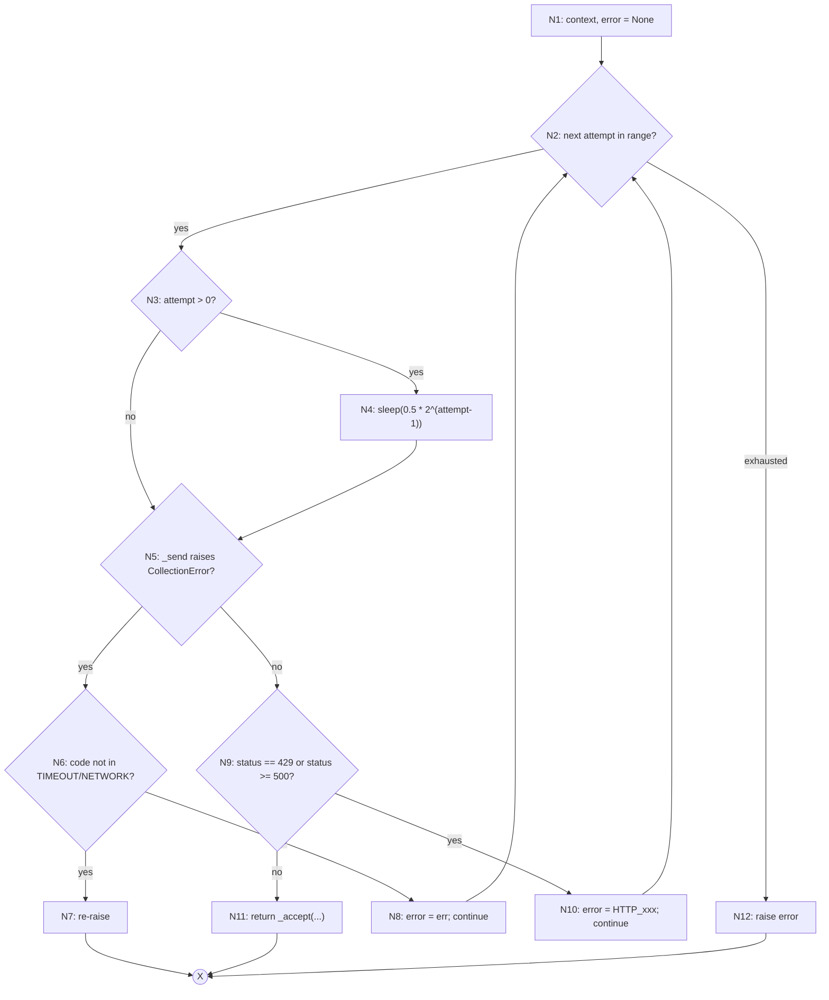
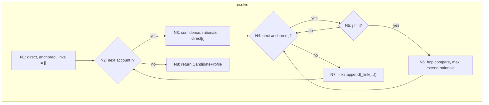
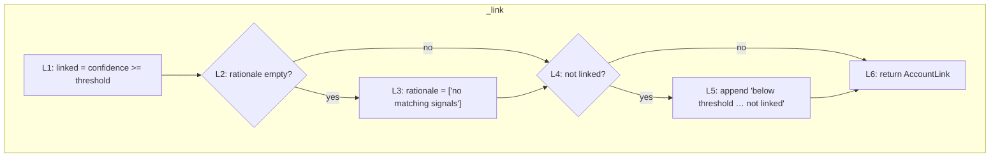
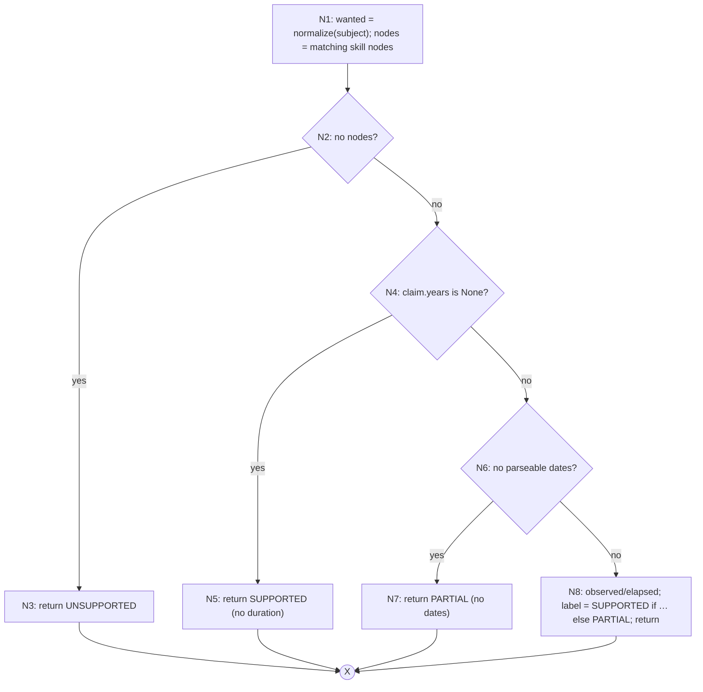
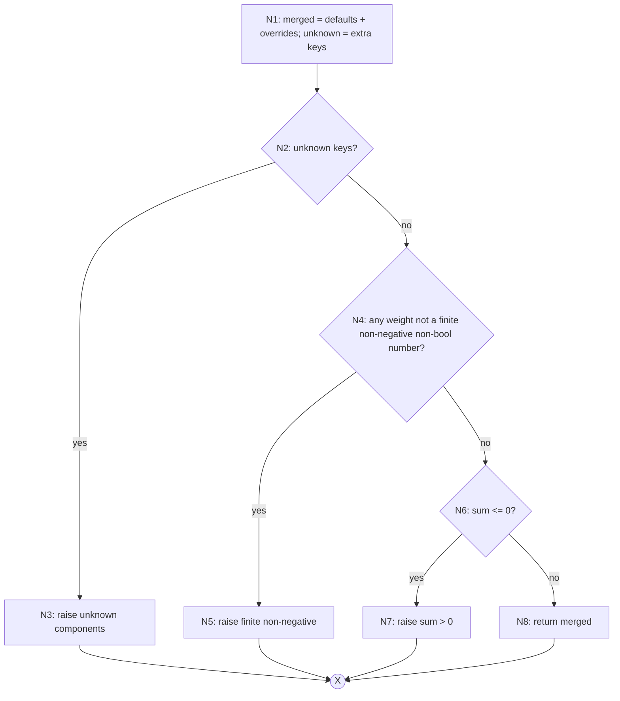

# White-Box Test Design — Milestone 2 (SE431)

Prepared by Ilsa Maryam (white-box design lead), week 10. Technique: basis-path testing (McCabe) from the control
flow graph (CFG), supplemented by condition coverage for compound predicates that McCabe does not count and by loop
coverage. Tests: `tests/whitebox/`. Raw run and coverage output: `docs/records/m2/whitebox-coverage.txt`.

## 0. Method

**Function selection.** The functions below are the ones in `pipeline/core` where a wrong branch harms a real
person or breaks a Must requirement, and that hold real decision logic (V(G) ≥ 3):

| # | Function | File | Module / owner | Why it matters | Requirements |
|---|---|---|---|---|---|
| 1 | `Collector._fetch` | `pipeline/core/collection/collector.py` | M1 / Zain Jamshaid | Retry loop with back-off; decides retry vs fail for every request | FR-05, NFR-02, QR-04 |
| 2 | `IdentityResolver.resolve` + `_link` | `pipeline/core/identity/resolver.py` | M3 / Ilsa Maryam | Decides whose evidence is attributed to the candidate | FR-08, FR-09 |
| 3 | `SkillClaimRule.verify` | `pipeline/core/scoring/rules.py` | M5 / Ilsa Maryam | Labels resume claims supported / partial / unsupported | FR-12, QR-01 |
| 4 | `_validated` (weights of `WeightedEvidenceScoring`) | `pipeline/core/scoring/scoring.py` | M5 / Ilsa Maryam | Guards the score formula against bad configuration | FR-13, QR-03 |

`RateLimiter.__aenter__` (V(G) = 2) was considered and dropped: one try/except, already fully covered by
`tests/unit/collection/test_rate_limiter.py::test_slot_is_released_when_the_body_raises`.

**CFG conventions.** One node per basic block; the number is the node id used in test docstrings. Consecutive
statements with no branch are merged. A function with several `return`/`raise` statements gets a virtual exit node
`X` so the graph has one exit. List/generator comprehensions are treated as a single process node, as McCabe/Ruff
does (their hidden filters are noted where they matter).

**Cyclomatic complexity, three ways.** (1) V(G) = E − N + 2 on the CFG; (2) V(G) = P + 1 where P is the number of
predicate nodes (a loop header counts as one predicate; a `try/except` counts as one predicate on the try node);
(3) V(G) = number of regions of the planar CFG, including the outer region. Each value is cross-checked against
Ruff's McCabe implementation (ruff 0.17.5):

```
$ .venv/Scripts/python -m ruff check <file> --select C901 --config "lint.mccabe.max-complexity=0" --output-format concise
pipeline\core\collection\collector.py:40:15: C901 `_fetch` is too complex (6 > 0)
pipeline\core\identity\resolver.py:44:9: C901 `resolve` is too complex (4 > 0)
pipeline\core\identity\resolver.py:61:9: C901 `_link` is too complex (3 > 0)
pipeline\core\scoring\rules.py:63:9: C901 `verify` is too complex (4 > 0)
pipeline\core\scoring\scoring.py:68:5: C901 `_validated` is too complex (4 > 0)
```

(Only the matching lines of each file's output are quoted.) Ruff, like the original mccabe tool, counts statements
(`if`, `for`, `while`, `except`, …) but **not** boolean operators or conditional expressions. Where a function has a
compound predicate (`a or b`) or a conditional expression, it is called out and covered by an extra
condition-coverage test; the basis-path count stays the McCabe value.

**Linear independence.** Every basis-path set was checked mechanically: each path was turned into an edge-count
vector and the rank of the set computed with exact fractions (a 30-line Python script in the session scratchpad; it
is not a repository file). The output was:

```
fetch edges 17 rank 5 [1, 2, 3, 4, 5, 5]      <- 5 feasible paths + "TIMEOUT then success" do not reach 6
with infeasible 1-2-3-4-5-9-11-X 6            <- the 6th basis vector is only reachable through an infeasible path
with infeasible 1-2-12-X 6
resolve edges 10 rank 4 [1, 2, 3, 4]
link edges 7 rank 3 [1, 2, 3]
verify edges 11 rank 4 [1, 2, 3, 4]
```

`_validated` has the same graph shape as `verify` (three guard clauses), so it has the same rank result.

**Test IDs.** `WB-<MOD>-NN`, with `MOD` ∈ {`COL` (M1), `IDN` (M3), `SCO` (M5)}. Each test's docstring carries its id
and the path as a node sequence.

---

## 1. `Collector._fetch` (M1) — `pipeline/core/collection/collector.py`

### 1.1 Code with node numbers

```python
40  async def _fetch(self, handle, endpoint, url, params=None, json_body=None) -> tuple[RawFetch, object]:
44      context = {"source": self.source_name, "endpoint": endpoint, "url": url}  # N1
45      error = None                                                              # N1
46      for attempt in range(self._config.max_retries + 1):                       # N2  loop predicate
47          if attempt:                                                           # N3  predicate
48              await self._sleep(BACKOFF_BASE * 2 ** (attempt - 1))             # N4
49          try:                                                                  # N5  predicate (raises?)
50              response = await self._send(url, params, json_body)               # N5
51          except CollectionError as err:
52              if err.code not in TRANSIENT_CODES:                               # N6  predicate
53                  raise                                                         # N7  exit
54              error = err                                                       # N8
55              continue                                                          # N8  -> N2
56          if response.status == 429 or response.status >= 500:                  # N9  predicate (compound)
57              error = CollectionError(f"HTTP {response.status}", ...)           # N10
58              continue                                                          # N10 -> N2
59          return self._accept(handle, endpoint, response, context)              # N11 exit
60      raise error                                                               # N12 exit
```

### 1.2 Control flow graph



### 1.3 Cyclomatic complexity

| Method | Working | V(G) |
|---|---|---|
| E − N + 2 | E = 17 (N1→N2, N2→N3, N2→N12, N3→N4, N3→N5, N4→N5, N5→N6, N5→N9, N6→N7, N6→N8, N8→N2, N9→N10, N9→N11, N10→N2, N7→X, N11→X, N12→X); N = 13 (N1–N12, X) | 17 − 13 + 2 = **6** |
| P + 1 | Predicates N2 (loop), N3, N5 (try/except), N6, N9 → P = 5 | 5 + 1 = **6** |
| Regions | R1 {N3,N4,N5} back-off diamond; R2 {N2,N3,N5,N6,N8} transient-error retry loop; R3 {N2,N3,N4,N5,N9,N10} status retry loop; R4 {N5,N6,N7,X,N11,N9}; R5 {N2,N10,N9,N11,X,N12}; R6 outer | **6** |
| Ruff C901 | `_fetch is too complex (6 > 0)` | **6** ✔ |

Note: N9 is a compound predicate (`429 or ≥ 500`). Counting conditions instead of decisions would give 7; Ruff
counts decisions, so the basis set has 6 paths and the two operands are covered separately by WB-COL-06.

### 1.4 Basis paths

| Path | Node sequence | Feasible? |
|---|---|---|
| P1 | 1-2-3-5-9-11-X | yes — success on first attempt |
| P2 | 1-2-3-5-9-10-2-12-X | yes — retryable status, no retries configured |
| P3 | 1-2-3-5-6-7-X | yes — non-transient transport error |
| P4 | 1-2-3-5-6-8-2-12-X | yes — transient error, no retries configured |
| P5 | 1-2-3-5-9-10-2-3-4-5-9-11-X | yes — retry with back-off, then success |
| P6 | 1-2-3-4-5-9-11-X (or 1-2-12-X) | **no** — see below |

**P6 is infeasible.** The edge-vector rank check above shows that the five feasible paths have rank 5, and that the
sixth basis vector can only be completed by an infeasible path. The reason is structural: on the first iteration
`attempt == 0`, so N3 always goes straight to N5 (edge N3→N5 is taken exactly once on every real execution), and
`range(max_retries + 1)` always yields at least one value because `RunConfig` rejects `max_retries` outside [0, 3]
(`pipeline/core/inputs.py`). So "sleep before the first attempt" and "zero loop iterations" cannot happen. All 17
edges are still covered by P1–P5. This is the expected outcome for a counted loop whose first iteration is
special, and it is recorded rather than forced with a test that bypasses validation.

### 1.5 Test cases

| ID | Path | Input (fake HTTP route for the URL; `max_retries`) | Expected output | Req |
|---|---|---|---|---|
| WB-COL-01 | P1 | 200 `{"login": "octo"}`; 3 | returns `(RawFetch, {"login": "octo"})`, payload bytes kept, 1 call, no sleep | FR-02, FR-06 |
| WB-COL-02 | P2 | 503; 0 | `CollectionError` code `HTTP_503` with context {source, endpoint, url}; 1 call; no sleep | FR-05, NFR-02 |
| WB-COL-03 | P3 | raises `CollectionError(code="NETWORK_DISABLED")`; 3 | same error re-raised; 1 call; no sleep | FR-14, NFR-02 |
| WB-COL-04 | P4 | raises `CollectionError(code="TIMEOUT")`; 0 | `CollectionError` code `TIMEOUT`; 1 call; no sleep | FR-05 |
| WB-COL-05 | P5 | [503, 200 `{"ok": true}`]; 3 | returns `{"ok": True}`; 2 calls; sleeps `[0.5]` | FR-05 |
| WB-COL-06 | N9 conditions | first status ∈ {429, 499, 500, 599} then 200; 1 | 429, 500, 599 retried (2 calls); 499 not retried → `HTTP_499` (1 call) | FR-05 |
| WB-COL-07 | N2 loop at maximum | 503 forever; 3 | `HTTP_503`; 4 calls; sleeps `[0.5, 1.0, 2.0]` | FR-05 ("at most three retries") |

Implemented in `tests/whitebox/test_basis_paths_collection.py` with `FakeHttpClient` (`pipeline/adapters/fakes.py`),
a recording `sleep` and `RateLimiter(1, 0.0)`.

---

## 2. `IdentityResolver.resolve` and `_link` (M3) — `pipeline/core/identity/resolver.py`

### 2.1 Code with node numbers

```python
44  def resolve(self, candidate_id, run_id, anchor, accounts) -> CandidateProfile:
47      direct = [self._compare(anchor, account) for account in accounts]                          # N1
48      anchored = [i for i, (confidence, _) in enumerate(direct) if confidence >= self._threshold]  # N1
49      links = []                                                                                   # N1
50      for i, account in enumerate(accounts):                                                       # N2 loop
51          confidence, rationale = direct[i]                                                        # N3
52          for j in anchored:                                                                       # N4 loop
53              if j != i:                                                                           # N5
54                  hop_confidence, hop_reasons = self._compare(accounts[j], account)               # N6
56                  confidence = max(confidence, min(hop_confidence, direct[j][0]))                 # N6
57                  rationale = rationale + hop_reasons                                              # N6
58          links.append(self._link(candidate_id, run_id, account, confidence, rationale))          # N7
59      return CandidateProfile(candidate_id, tuple(links))                                          # N8 exit

61  def _link(self, candidate_id, run_id, account, confidence, rationale) -> AccountLink:
62      linked = confidence >= self._threshold                                   # L1
63      if not rationale:                                                        # L2
64          rationale = ["no matching signals"]                                  # L3
65      if not linked:                                                           # L4
66          rationale = [*rationale, f"below threshold {self._threshold:.2f} — not linked"]  # L5
67      return AccountLink(..., confidence, linked, tuple(rationale))            # L6 exit
```

(Line 55 is a comment. Line 56 was changed during M2 by inspection defect INS-09 — a hop is now capped by the hop
account's own confidence; the CFG is unchanged by that fix.)

### 2.2 Control flow graphs





### 2.3 Cyclomatic complexity

| Function | E − N + 2 | P + 1 | Regions | Ruff C901 |
|---|---|---|---|---|
| `resolve` | E = 10 (1→2, 2→3, 2→8, 3→4, 4→5, 4→7, 5→6, 5→4, 6→4, 7→2), N = 8 → **4** | N2, N4, N5 → **4** | {N4,N5} (5→4 back edge), {N4,N5,N6}, {N2,N3,N4,N7}, outer → **4** | `resolve … (4 > 0)` ✔ |
| `_link` | E = 7 (L1→L2, L2→L3, L2→L4, L3→L4, L4→L5, L4→L6, L5→L6), N = 6 → **3** | L2, L4 → **3** | {L2,L3,L4}, {L4,L5,L6}, outer → **3** | `_link … (3 > 0)` ✔ |

Hidden decision not counted by McCabe: the filter `if confidence >= self._threshold` inside the `anchored`
comprehension (N1). Its two outcomes are exercised by WB-IDN-02 (not anchored) and WB-IDN-03 (anchored).

### 2.4 Basis paths and test cases

`resolve` — all four paths feasible:

| ID | Path | Input (anchor = résumé "Ilsa Maryam", ilsa@example.com) | Expected output | Req |
|---|---|---|---|---|
| WB-IDN-01 | 1-2-8 | `accounts = []` | `CandidateProfile("cand-1", ())` | FR-08 |
| WB-IDN-02 | 1-2-3-4-7-2-8 | one GitHub account; one signal scoring 0.3 (weight 1.0) | confidence 0.3, `linked = False` (nothing anchored, inner loop runs 0 times) | FR-09 |
| WB-IDN-03 | 1-2-3-4-5-4-7-2-8 | one account; signal scoring 1.0 | confidence 1.0, linked, exactly one rationale line (no self-hop) | FR-08 |
| WB-IDN-04 | 1-2-3-4-5-4-7-2-3-4-5-6-4-7-2-8 | default signals; GitHub `octo-dev` with the résumé email, LeetCode `lc_user` linking to `github.com/octo-dev` | GitHub: 0.9, linked, 1 rationale line. LeetCode: 0.9 via the hop (direct 0.0), linked, rationale contains `github:octo-dev~leetcode:lc_user` | FR-08, FR-09 |

`_link` — all three paths feasible:

| ID | Path | Input | Expected output | Req |
|---|---|---|---|---|
| WB-IDN-05 | L1-L2-L4-L6 | signal 0.8, threshold 0.50 | linked; rationale = `("fixed (0.80) on resume~github:octo: fixed 0.8",)` unchanged | FR-08 |
| WB-IDN-06 | L1-L2-L3-L4-L6 | signal 0.0, **threshold 0.0** | confidence 0.0, linked (boundary: equal counts as linked); rationale = `("no matching signals",)` | FR-08, FR-09 |
| WB-IDN-07 | L1-L2-L4-L5-L6 | signal 0.3, threshold 0.50 | not linked; rationale = signal line + `"below threshold 0.50 — not linked"` | FR-09 |

The fourth combination (L1-L2-L3-L4-L5-L6: no signal and not linked) is linearly dependent on the three above and
is already exercised by `tests/unit/identity/test_resolver.py::test_account_with_no_matching_signal_is_not_linked_by_default`.

Implemented in `tests/whitebox/test_basis_paths_identity.py`; a `FixedSignal` stub (fires only on pairs that include
the résumé anchor) makes each confidence exact.

---

## 3. `SkillClaimRule.verify` (M5) — `pipeline/core/scoring/rules.py`

### 3.1 Code with node numbers

```python
63  def verify(self, claim, evidence, run_id) -> Verdict:
64      wanted = self._normalizer.normalize(claim.subject)                                    # N1
65      nodes = [n for n in evidence if n.kind == "skill" and normalize(n.value.get("name")) == wanted]  # N1
66      if not nodes:                                                                          # N2
67          return _verdict(claim, run_id, UNSUPPORTED, [], ...)                               # N3 exit
68      found = f"{len(nodes)} '{wanted}' skill node(s)"                                       # N4
69      if claim.years is None:                                                                # N4
70          return _verdict(claim, run_id, SUPPORTED, nodes, f"{found}; no duration claimed")  # N5 exit
71      dates = _seen_dates(nodes)                                                             # N6
72      if not dates:                                                                          # N6
73          rationale = f"{found} but no dates to check {claim.years:g} claimed year(s)"       # N7
74          return _verdict(claim, run_id, PARTIAL, nodes, rationale)                          # N7 exit
75      observed = _whole_years(min(dates), max(dates))                                        # N8
76      elapsed = _elapsed_years(min(dates), max(dates))                                       # N8
77      label = SUPPORTED if observed >= claim.years or elapsed >= claim.years else PARTIAL    # N8 (hidden decision)
78-81    rationale = (...)                                                                      # N8
82      return _verdict(claim, run_id, label, nodes, rationale)                                # N8 exit
```

Lines 76–77 were added during M2 by inspection defect INS-05 (fractional claimed years); the McCabe CFG did not
change because the new decision is a conditional expression.

### 3.2 Control flow graph



### 3.3 Cyclomatic complexity

| Method | Working | V(G) |
|---|---|---|
| E − N + 2 | E = 11 (1→2, 2→3, 2→4, 4→5, 4→6, 6→7, 6→8, 3→X, 5→X, 7→X, 8→X), N = 9 | **4** |
| P + 1 | N2, N4, N6 | **4** |
| Regions | {N2,N3,X,N5,N4}, {N4,N5,X,N7,N6}, {N6,N7,X,N8}, outer | **4** |
| Ruff C901 | `rules.py:63:9: verify … (4 > 0)` (the other `verify` lines in that file are `VerificationRule.verify` = 1 and `RatingClaimRule.verify` = 6) | **4** ✔ |

### 3.4 Basis paths and test cases

| ID | Path | Input | Expected output | Req |
|---|---|---|---|---|
| WB-SCO-01 | 1-2-3-X | claim "Python", 2 years; evidence: skill "Go" and a **project** node named "Python" | `unsupported`, no node ids, rationale `no 'python' skill evidence found` (non-skill node filtered out) | FR-12, QR-01 |
| WB-SCO-02 | 1-2-4-5-X | claim "Python", no years; skill "py" | `supported`, ids `("n1",)`, rationale ends `no duration claimed` (alias normalised) | FR-10, FR-12 |
| WB-SCO-03 | 1-2-4-6-7-X | claim 2 years; skill Python with `first_seen=None`, `last_seen="not-a-date"` | `partially_supported`, rationale `1 'python' skill node(s) but no dates to check 2 claimed year(s)` | FR-12 |
| WB-SCO-04 | 1-2-4-6-8-X | claim 2 years; Python seen 2020-01-01T00:00:00Z → 2022-01-01T00:00:00Z | `supported` (boundary: observed = claimed = 2) | FR-12, QR-01 |
| WB-SCO-05 | N8 conditional expression | (a) 2.5 years, 2020-01-01 → 2022-12-01; (b) 2 years, 2020-01-02 → 2022-01-01 | (a) `supported` (whole years 2 < 2.5 but elapsed 2.92 ≥ 2.5); (b) `partially_supported` (1 whole year, elapsed one day short of 2) | FR-12, QR-01 |

WB-SCO-04 covers the first operand of the N8 condition true; WB-SCO-05 covers (false, true) and (false, false).

---

## 4. `_validated` (M5) — `pipeline/core/scoring/scoring.py`

### 4.1 Code with node numbers

```python
68  def _validated(weights: dict | None) -> dict:
69      merged = {**DEFAULT_WEIGHTS, **(weights or {})}                                    # N1
70      unknown = set(merged) - set(DEFAULT_WEIGHTS)                                       # N1
71      if unknown:                                                                         # N2
72          raise ScoringError(f"unknown score components {sorted(unknown)}", ...)         # N3 exit
73      if any(not isinstance(w, (int, float)) or isinstance(w, bool) or not 0 <= w < math.inf
               for w in merged.values()):                                                   # N4 (compound)
74          raise ScoringError("weights must be finite non-negative numbers", ...)         # N5 exit
75      if sum(merged.values()) <= 0:                                                       # N6
76          raise ScoringError("weights must sum to more than 0", ...)                     # N7 exit
77      return merged                                                                       # N8 exit
```

Line 73 was tightened during M2 (`w < 0` → `not 0 <= w < math.inf`). The white-box analysis found the gap
independently (anomaly **WB-DEF-01**, section 6); it was logged and fixed as inspection defect INS-08.

### 4.2 Control flow graph



### 4.3 Cyclomatic complexity

| Method | Working | V(G) |
|---|---|---|
| E − N + 2 | E = 11, N = 9 (same shape as section 3) | **4** |
| P + 1 | N2, N4, N6 | **4** |
| Regions | three guard-clause regions + outer | **4** |
| Ruff C901 | `scoring.py:68:5: _validated … (4 > 0)` | **4** ✔ |

### 4.4 Basis paths and test cases

| ID | Path | Input to `WeightedEvidenceScoring(weights)` | Expected output | Req |
|---|---|---|---|---|
| WB-SCO-06 | 1-2-3-X | `{"charisma": 1.0}` | `ScoringError` "unknown score components" | FR-13 |
| WB-SCO-07 | 1-2-4-5-X | `{"verified_skills": -0.01}` | `ScoringError` "…non-negative…" | FR-13 |
| WB-SCO-08 | 1-2-4-6-7-X | all four weights 0 | `ScoringError` "weights must sum to more than 0" | FR-13 |
| WB-SCO-09 | 1-2-4-6-8-X | `None`; and `{"requirement_match": 0.5}` | report weights equal `DEFAULT_WEIGHTS`; override merged by name | FR-13, QR-03 |
| WB-SCO-10 | N4 conditions | `verified_skills` ∈ {`True`, `"0.3"`, `None`, `0`, `0.0`} | bool, string, None rejected; int 0 and float 0.0 accepted (others still sum > 0) | FR-13 |
| WB-SCO-11 | N4 range operand | `verified_skills` ∈ {NaN, +inf} | `ScoringError` "finite non-negative" | FR-13, QR-03 |

Implemented in `tests/whitebox/test_basis_paths_scoring.py` (sections 3 and 4).

---

## 5. Results

### 5.1 Execution

`.venv/Scripts/python -m pytest tests/whitebox -q --cov=pipeline/core --cov-branch --cov-report=term-missing`
→ **34 passed** (25 test IDs; WB-COL-06, WB-SCO-05, WB-SCO-10 and WB-SCO-11 are parametrised). Full output:
`docs/records/m2/whitebox-coverage.txt`.

### 5.2 Per-function coverage achieved by `tests/whitebox` alone

From the `functions` section of `coverage json` for the same run (coverage.py 7.16.2):

| Function | V(G) | Basis paths (feasible) | WB IDs | Statements (missed) | Branches covered | Branch coverage |
|---|---|---|---|---|---|---|
| `Collector._fetch` | 6 | 6 (5) | WB-COL-01…07 | 17 (0) | 8 / 8 | 100 % |
| `IdentityResolver.resolve` | 4 | 4 (4) | WB-IDN-01…04 | 12 (0) | 6 / 6 | 100 % |
| `IdentityResolver._link` | 3 | 3 (3) | WB-IDN-05…07 | 6 (0) | 4 / 4 | 100 % |
| `SkillClaimRule.verify` | 4 | 4 (4) | WB-SCO-01…05 | 16 (0) | 6 / 6 | 100 % |
| `_validated` | 4 | 4 (4) | WB-SCO-06…11 | 9 (0) | 6 / 6 | 100 % |

coverage.py measures arcs between lines, so it cannot see the operands of a compound predicate or a conditional
expression; those are the reason for WB-COL-06, WB-SCO-05 and WB-SCO-10/11. Basis-path coverage is stronger than
branch coverage here: 100 % branch coverage of `_fetch` is reached by P1–P5 alone, while WB-COL-06/07 add the
condition and loop-limit cases.

### 5.3 Whole-suite context

`pytest -m "not integration" --cov=pipeline/core --cov-branch` (all suites incl. white-box):
see `docs/records/m2/coverage-full.txt` and the V&V plan (`docs/milestone2/vv-plan.md`, section 7).

## 6. Anomalies found by white-box analysis

| ID | Function | Finding | Severity | Status |
|---|---|---|---|---|
| WB-DEF-01 | `_validated` | Node N4 checked `w < 0` only, so `float("nan")` and `float("inf")` passed validation. Reproduced before the fix: `WeightedEvidenceScoring({"verified_skills": nan})` gave a report whose `verified_skills` weight was `nan` and **total 0.0 for a candidate whose only verdict was `supported`** (same with `inf`). Weights are not reachable from the REST API (only from the constructor), so the impact is latent. | Medium as raised by WB; the inspection rated INS-08 Low (not reachable from the API). Agreed severity to settle at the M3 defect review | Found independently by the Fagan inspection as INS-08 and fixed in `scoring.py` line 73; regression tests WB-SCO-11 and `tests/unit/scoring/test_inspection_m2_scoring.py::test_ins08_*` pass. |
| WB-OBS-01 | `Collector._fetch` | `raise error` at N12 would raise `TypeError` (`raise None`) if the loop ever ran zero times. Unreachable today only because `RunConfig` limits `max_retries` to [0, 3]. | Low (robustness) | Reported, not fixed (source owned by M1). Suggest an `assert`/explicit error, or keep the `RunConfig` guard covered by `test_run_config_max_retries_boundaries`. |
| WB-OBS-02 | `IdentityResolver._link` | With `threshold = 0.0` an account with no matching signal at all is reported as **linked** (WB-IDN-06). This is what FR-09 literally says (confidence ≥ threshold) but is surprising for an identity decision. | Low (spec question) | Raised for the M3 requirement review: consider requiring `threshold > 0` in `RunConfig`. |
